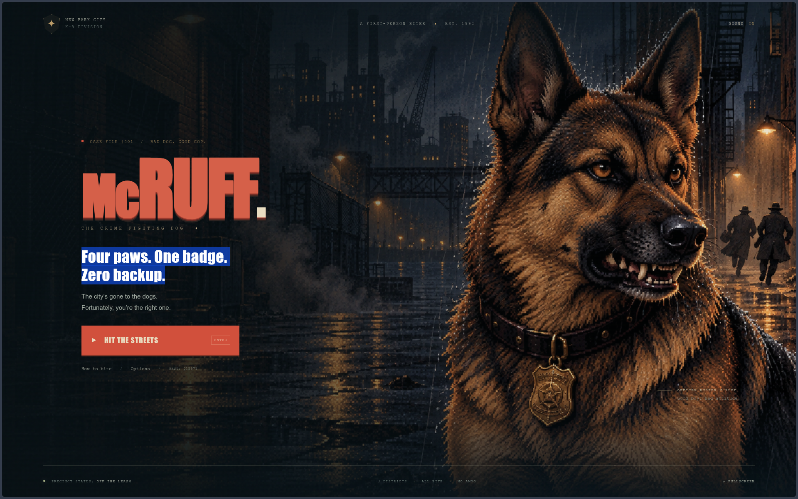

# McRuff: Bite the Crime

**Four paws. One badge. Zero backup.**

A complete retro first-person biter, built with HTML5 Canvas and native JavaScript. Play as Officer Buster McRuff, clean up New Bark City, and collar Big Lou.



## Play

```sh
npm start
```

Open **http://localhost:4173** in a modern browser. Requires Node.js 22 or newer for the development commands; there are no packages to install. The game itself runs entirely in the browser.

Use `PORT=8080 npm start` to choose another port. The `dist/` directory is the complete static game and can be hosted on any static web server. JavaScript modules need an HTTP server; opening `index.html` directly from the filesystem is not supported.

For Netlify, the included `netlify.toml` publishes `dist/` directly with no build command.

## Controls

| Action | Control |
|---|---|
| Move forward/backward | W/S, or up/down arrows; hold the middle mouse button to move forward |
| Look left/right | A/D, mouse, or left/right arrows |
| Strafe left/right | Q/E |
| Bite and lunge | Left mouse button or Space; hold to keep biting |
| Stun bark | R or right mouse button |
| Sprint | Shift |
| Scent map | M or the map button |
| Pause | Escape, P, or the pause button |
| Fullscreen | F during a game |

Open **Options → Key bindings**, or choose **Key bindings** while paused, to change any keyboard control. Click an action or use Tab and Enter, then press its new key. Changes save automatically. Assigning a key already in use swaps the two actions. Escape cancels a pending change, and **Restore defaults** returns to the controls above. Escape always remains available to pause.

On touchscreens, move with the left joystick, drag the view to look, and use the Bite/Bark buttons. Landscape gives you the widest view. If mouse capture is unavailable in an embedded browser, A/D or arrow keys and Space still work.

## Your beat

- **The Backstreets:** learn to put the Bone Street gang on a leash.
- **The Meatpacking District:** shut down the stolen-treat operation.
- **The Docks:** collar the kingpin, Big Lou.

Arrest every suspect in a district, then walk into the green **EXIT** beacon. The scent map shows suspects, pickups, and extraction. Bite at close range; bark stuns nearby visible enemies and destroys nearby thrown bottles. Every goon can wind up and swat you with a rolled newspaper. Backstep out of reach or bark before the swing lands. On Normal and Hard, nonlethal bites cannot interrupt a raised newspaper, so holding bite in place will get you swatted. Big Lou carries the Sunday edition. Steak heals 35 health, vests absorb damage, and the six hidden golden bones award bonus points. Chain arrests quickly for a score multiplier.

The gang pursues sooner, moves faster, and recovers more quickly between swats. Bottle throwers also fire faster bottles more often. Thugs take three bites, throwers two, brutes five, and Big Lou sixteen. Newspaper hits on Normal deal 14 / 12 / 22 / 28 damage respectively, before armor. The warning remains just over half a second (longer for brutes and Big Lou) on every difficulty.

- **Good boy · Easy:** slower enemies, reduced damage, long bark stuns, bites can interrupt swings, +5 health per arrest, and full health between districts.
- **Street dog · Normal:** no healing from arrests, +20 health between districts, and a 1.25-second bark stun (half for Big Lou).
- **Unleashed · Hard:** 35% more damage than Normal, 15% faster enemies and bottles, faster attack recovery, a 0.9-second bark stun (half for Big Lou), and only +10 health between districts.

Includes three difficulty settings, a synthesized soundtrack and effects, reduced screen motion, pause on lost focus, local best scores, and a complete victory/retry loop. No accounts, tracking, runtime dependencies, or network services.

## Cat patrol

Those oil drums and wooden crates have a purr-blem. **Bark near an unopened drum or crate** to make it visibly rattle. **Bite it** to launch **1–4 cats** in an outward arc. Each hiding spot opens once per case: drums keep their lids open and crates are left cracked and splintered.

Cats wander until you approach, then run away. Barking makes them meow and bolt faster; it **never stuns them**. Catch up, face the cat, and **press your bite key for a gentle grab**. Cats must land before you can catch them. Normal movement can catch a fleeing cat, and sprinting helps after a bark.

| Cat | Rarity | Chance per cat | Capture bonus |
|---|---|---|---|
| Alley Tabby | Common | 60% | 100 |
| Sir Pounce | Uncommon | 25% | 250 |
| Lilac Loafer | Rare | 12% | 600 |
| The Great Catsby | Legendary | 3% | 1,500 |

The Cat Patrol counter opens your collection, also available in the pause menu. The scent map marks loose cats and unopened drums and crates; rare and legendary cats have labels in the world. Captures and bonuses carry across the three districts of the current case and appear on the results screen. Starting a new case resets the collection. Uncaught cats never block extraction, so finish your cat hunt before leaving a district.

**Bark at the garbage can** for an increasingly grumpy surprise. The first bark gets “SCRAM!”, the second gets “I TOLD YOU, SCRAM!”, and the third makes him throw a random chew bone, steak, or cat toward you. Bones land as +100-point treats, steaks heal 35 health, and cats land and join the chase. These chew bones are separate from the six hidden golden bones. On the fourth bark, he does a cartoon death flop over the rim, eyes closed and tongue out, and stays there for the rest of the case. Each can remembers its own annoyance level; the normal bark cooldown still applies. This cameo does not count as an arrest or block extraction.

## Development

```sh
npm test
npm run check
```

The behavioral tests cover collision, combat reach and occlusion, stun cooldown, pickups, newspaper wind-ups, dodging, interruptions, enemy damage, level reachability, exits, keyboard bindings, conflicting key swaps, saved controls, drum and crate rattles and one-time launches, garbage-can peeks and retreat timing, the grouch's four stages and all three thrown rewards, cat flight and wall collisions, wandering and fleeing, gentle captures and rarity rewards, collection carryover, optional extraction, difficulty-dependent healing and stun windows, resistance to endless bite interruptions, and complete campaigns on all three difficulties using real movement and combat. The simulated player allows 200 ms to react to newspaper warnings before barking or backstepping.

Browser verification covered keyboard movement, live combat, bark, map, pause, settings, restart, death, all district transitions, and victory. Keyboard-only rebinding, conflict swaps, cancellation, restored defaults, and persistence after reload were also verified. A touch-enabled 390 × 844 browser passed joystick movement, bark, and pause checks. The bindings menu was checked at desktop, 390-pixel, and 320-pixel widths, including keyboard focus navigation. Screenshots were reviewed at desktop and portrait sizes; no browser script errors were observed.

`tests/cats.browser.js` is a repeatable browser check for the cat loop, quick bite taps, remapped capture keys, pause behavior, narrow layouts, keyboard focus, and touch captures. Run it with Playwright's `browser_run_code_unsafe` filename option while the preview server is running. It uses an isolated browser context and adds inspection hooks only to that context's served response.

`tests/difficulty.browser.js` uses the same isolated setup to verify live keyboard bite damage, bark interruption, backstep dodges, difficulty selection, limited district healing, and the updated field manual on a narrow screen.

## Project map

- `dist/src/game.js`: simulation, combat, movement, enemy navigation, and scoring.
- `dist/src/world.js`: shared collision, movement, and line-of-sight geometry.
- `dist/src/cats.js`: cat rarity, launches, wandering, fleeing, and capture rewards.
- `dist/src/grouch.js`: escalating garbage-can reactions, thrown rewards, and the permanent flop.
- `dist/src/levels.js`: the three districts and their entities.
- `dist/src/renderer.js`: raycast world, floor casting, sprites, weather, and minimap.
- `dist/src/art.js`: original procedural pixel textures, sprites, and Buster's snout.
- `dist/src/audio.js`: Web Audio music and effects.
- `dist/src/main.js`: menus, input, preferences, and game loop.
- `dist/src/bindings.js`: keyboard defaults, remapping, conflict swaps, and input actions.
- `dist/assets/cover.png`: original cover artwork made with the built-in image-generation tool. The exact prompt is in `docs/cover-art-prompt.txt`.

The title illustration is AI-generated. All other art and sound are generated by the game's own code. No Doom artwork, music, or code is used.
